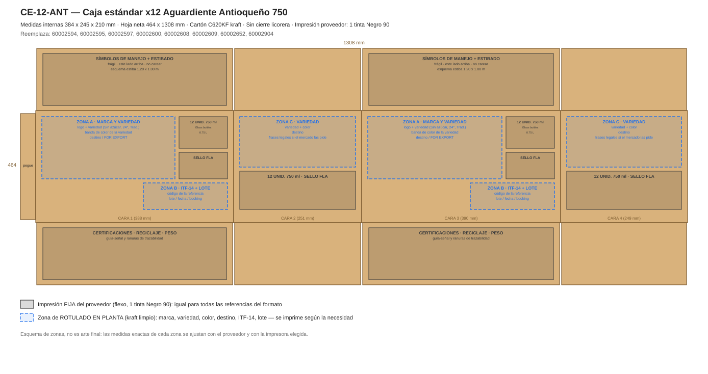

# Propuesta: caja estándar 750 ml para rotular en planta

**Objetivo:** pedirle al proveedor pocas cajas "base", iguales para muchas referencias, y darles el
toque final aquí con nuestras impresoras: marca, variedad, color, destino, código y lote, según la
necesidad.

**Base del análisis:** las 17 fichas técnicas de la carpeta [`Listado cajas`](../Listado%20cajas)
(todas del mismo proveedor, mismo formato de ficha) y el Excel del listado.

---

## 1. Qué encontramos

### 1.1 Todas las cajas son técnicamente muy parecidas
- Cartón corrugado **kraft**: **C620KF** en las x12 de exportación y **C540 KF** en el resto.
- Particiones y divisiones en **BX1K kraft, sin impresión**.
- Impresión flexo base agua de **1 o 2 tintas**: **Negro 90** más un color de la variedad.
- Atados de 30 cajas y estiba de 1,20 × 1,00 m.

### 1.2 Cada botella define una familia
Las celdas de las particiones muestran tres botellas distintas:

| Botella | Celda aprox. (mm) | Alto interno caja |
|---|---|---|
| Aguardiente Antioqueño 750 | 96 × 81 | 208–210 |
| Real NI 750 | 88 × 88 | 243–245 |
| Herencia 750 | 77 × 100 | 222 |

### 1.3 Tabla de las 17 referencias

| Material | Descripción | Medidas int. (mm) | Cartón | Hoja neta (mm) | Área m² | Cierre | Tintas |
|---|---|---|---|---|---|---|---|
| 60002594 | x12 Sin azúcar USA | 384×245×210 | C620KF | 464×1308 | 0,607 | Sin cierre licorera | Azul 39 + Negro 90 |
| 60002595 | x12 Tradicional USA | 384×245×210 | C620KF | 464×1308 | 0,607 | Sin cierre licorera | Rojo 74 + Negro 90 |
| 60002597 | x12 24° USA | 384×245×210 | C620KF | 464×1308 | 0,607 | Sin cierre licorera | Verde 2081 + Negro 90 |
| 60002600 | x12 Sin azúcar Chile | 384×245×210 | C620KF | 464×1308 | 0,607 | Sin cierre licorera | Azul 39 + Negro 90 |
| 60002608 | x12 Tradicional Gene Exp | 384×245×210 | C620KF | 464×1308 | 0,607 | Sin cierre licorera | Rojo 73 + Negro 90 |
| 60002609 | x12 Sin azúcar Gene Exp | 384×245×210 | C620KF | 464×1308 | 0,607 | Sin cierre licorera | Azul 39 + Negro 90 |
| 60002652 | x12 24° Gene Exp | 384×245×210 | C620KF | 464×1308 | 0,607 | Sin cierre licorera | Verde 2081 + Negro 90 |
| 60002904 | x12 Antio Antio 24° Exp | 384×245×210 | C620KF | 464×1308 | 0,607 | Sin cierre licorera | Verde 2081 + Negro 90 |
| 60002579 | x20 Sin azúcar kit | 482×324×208 | C540 KF | 542×1662 | 0,901 | Licorera caras 1 y 4 con score | Azul 39 + Negro 90 |
| 60002580 | x20 24° kit | 482×324×208 | C540 KF | 542×1662 | 0,901 | Licorera caras 1 y 4 con score | Verde 2081 + Negro 90 |
| 60003294 | x12 Real 24° Exp NI | 348×260×245 | C620KF | 515×1266 | 0,652 | Sin cierre licorera | Negro 90 |
| 60003155 | x20 Real 24° NI | 445×360×243 | C540 KF | 613×1660 | 1,018 | Licorera con score, casquete | Negro 90 |
| 60003228 | x6 Herencia Sin azúcar 29° | 233×200×222 | C540 KF | 432×916 | 0,396 | Licorera con score, pegue afuera | Azul 39 + Negro 90 |
| 60003229 | x6 Herencia Sin azúcar 24° | 233×200×222 | C540 KF | 432×916 | 0,396 | Licorera con score, pegue afuera | Verde 2081 + Negro 90 |
| 60002004 | Estuche Aguardiente Real | 318×318×200 | C540 KF | 528×1322 | 0,698 | Licorera con score, pegue afuera | Gris H1709 + Negro 90 |
| 60003257 | x6 Estuche Real 24° + 2 copas | 302×269×246 | C540 KF | 524×1192 | 0,625 | Licorera con score, casquete | Negro 90 |
| 60003020 *(no activo)* | x6 Real 24° Gold | 318×212×238 | C540 KF | 460×1110 | 0,511 | Licorera sin score | Verde 3213 + Negro 90 |

### 1.4 Lo más importante: muchas cajas ya son la misma caja
- **Las 8 x12 de Antioqueño** tienen la misma caja (384×245×210, C620KF, hoja 464×1308), la misma
  partición (378×236×200) y la misma división (343×222). **Solo cambian el color de la tinta y el arte.**
  La única excepción es la partición de 60002597 (384×241×208).
- **Las 2 x20 de Antioqueño** (60002579 y 60002580) son idénticas entre sí.
- **Las 2 x6 Herencia** (60003228 y 60003229) son idénticas entre sí.
- Las 2 cajas Real NI ya se imprimen en **una sola tinta (Negro 90)**: están a un paso de ser estándar.

### 1.5 Qué información lleva cada caja

| Información | ¿Cambia por referencia? | ¿Quién la imprime en la propuesta? |
|---|---|---|
| Cantidad y "750 ml / Glass bottles" | No, depende del formato | Proveedor (fija) |
| Sello Fábrica de Licores, certificaciones, reciclaje | No | Proveedor (fija) |
| Símbolos de manejo (frágil, este lado arriba, no carear) y esquema de estibado | No | Proveedor (fija) |
| Peso aproximado de la caja vacía | No, depende del formato | Proveedor (fija) |
| Guía-señal y ranuras de trazabilidad del proveedor | No | Proveedor (fija) |
| Logo de marca (Antioqueño, Real, Herencia) | **Sí** | **Planta** |
| Variedad (Sin azúcar, Tradicional, 24°, 29°) y su color | **Sí** | **Planta** |
| Destino (USA, Chile, exportación general, nacional, "FOR EXPORT") | **Sí** | **Planta** |
| Código ITF-14 / DUN-14 | **Sí, uno por referencia** | **Planta** |
| Lote, fecha, booking | **Sí, por producción** | **Planta** |
| Frases legales ("El exceso de alcohol…", "Prohíbase el expendio…") | Depende del mercado | **Planta** (o fija si aplica a todos los mercados) |

---

## 2. Propuesta por grupos: 14 referencias → 5 cajas estándar

| Caja estándar | Reemplaza | Medidas int. (mm) | Cartón | Kit interior | Plano |
|---|---|---|---|---|---|
| **CE-12-ANT** x12 Antioqueño | 8 refs: 60002594, 2595, 2597, 2600, 2608, 2609, 2652, 2904 | 384×245×210 | C620KF | Partición 378×236×200 + división 343×222 | [ver](planos/CE-12-ANT.svg) |
| **CE-20-ANT** x20 Antioqueño | 2 refs: 60002579, 2580 | 482×324×208 | C540 KF | Partición 476×318×140 + división 456×282 | [ver](planos/CE-20-ANT.svg) |
| **CE-12-REAL** x12 Real NI | 60003294 | 348×260×245 | C620KF | Partición 346×258×185 + división 343×222 | [ver](planos/CE-12-REAL.svg) |
| **CE-20-REAL** x20 Real NI | 60003155 | 445×360×243 | C540 KF | Partición 440×356×243 + división 374×232 | [ver](planos/CE-20-REAL.svg) |
| **CE-06-HER** x6 Herencia | 2 refs: 60003228, 3229 | 233×200×222 | C540 KF | Partición 233×200×222 + división 230×150 | [ver](planos/CE-06-HER.svg) |

**Quedan por fuera, como cajas especiales:** el estuche Real (60002004), el estuche Real + 2 copas
(60003257) y la Real Gold (60003020, no activa). Son empaques de mercadeo o regalo, de bajo volumen y
con forma propia; no conviene forzarlos a un estándar.

> Se mantienen las **estructuras actuales** (medidas, cartón, cierre, particiones), que ya están
> probadas con las botellas. Lo único que cambia es **qué se imprime y quién lo imprime**.
> Así el riesgo es bajo: no hay que validar troqueles nuevos.

### Diseño de cada caja estándar
Los planos de la carpeta [`planos/`](planos) muestran la caja desplegada con dos tipos de zona:

- **Gris, impresión fija del proveedor** en 1 tinta Negro 90: cantidad + 750 ml, sello FLA, símbolos de
  manejo y estibado en las aletas superiores, certificaciones, reciclaje y peso en las aletas inferiores.
- **Azul punteado, rotulado en planta** sobre kraft limpio:
  - **Zona A, caras largas 1 y 3:** logo, variedad, banda de color de la variedad y destino.
  - **Zona B, caras largas 1 y 3, esquina inferior derecha:** ITF-14 y lote. Es la misma posición que
    tiene hoy, así los lectores de la línea y del cliente no cambian.
  - **Zona C, caras cortas 2 y 4:** variedad, color, destino y frases legales si el mercado las pide.

---

## 3. Tres niveles de "caja neutra" para escoger

| | **Idea 1: caja en blanco** | **Idea 2: semi-neutra (recomendada)** | **Idea 3: neutra + color de familia** |
|---|---|---|---|
| Qué imprime el proveedor | Nada, kraft limpio | Elementos fijos en Negro 90 (sección 1.5) | Lo fijo + una franja con el color de la marca o familia |
| Qué imprimimos aquí | Todo | Marca, variedad, color, destino, ITF-14, lote | Variedad, destino, ITF-14, lote |
| Cajas a pedir | 5 | 5 | 5 a 8 (una por color) |
| Costo de la caja | El más bajo, sin clisés | Bajo, 1 juego de clisés por formato | Medio |
| Carga de impresión en planta | Alta: hay que imprimir símbolos, sellos y certificaciones en cada caja | Media | Baja |
| Riesgo | Olvidar símbolos o sellos obligatorios | Bajo | Bajo, pero se pierde parte de la flexibilidad |

**Recomendación: Idea 2.** Deja en manos del proveedor lo que nunca cambia y en las nuestras todo lo
que diferencia una referencia de otra.

---

## 4. Cómo imprimir aquí: opciones de equipo

| Opción | Cómo funciona | Ventajas | Cuidados |
|---|---|---|---|
| **A. Etiqueta autoadhesiva** (térmica, por ejemplo 100×150 mm, o impresora de etiquetas a color) | Se imprime la etiqueta y se pega a mano o con un aplicador automático | Inversión baja. El código ITF-14 sobre fondo blanco se lee muy bien. Permite color (banda de variedad) | Costo de consumible por caja. Se necesita aplicador si el volumen es alto |
| **B. Inkjet directo sobre la caja** (cabezal piezoeléctrico de caracteres grandes o de alta resolución, en la línea o en la armadora) | Imprime logo, textos, código y lote directamente sobre el kraft | Sin etiquetas. Costo por caja muy bajo a volumen. Cambio de referencia por software | Inversión mayor. Normalmente 1 color (negro). El ITF-14 sobre kraft hay que **verificarlo** |
| **C. Mixta (recomendada)** | Inkjet negro para marca, variedad y lote + etiqueta con banda de color e ITF-14 | Lo mejor de las dos: identidad visual de color y código que siempre se lee | Dos equipos a coordinar |

**Sobre el color de la variedad:** hoy cada variedad tiene su tinta (Azul 39 Sin azúcar, Rojo 74/73
Tradicional, Verde 2081 24°). Con la caja neutra ese código de color se conserva con la **banda de
color en la etiqueta** (opción A o C) o con rollos de etiqueta preimpresos por color.

**Sobre el código de barras:** el ITF-14 es el punto técnico más delicado de imprimir en planta sobre
kraft. Antes de decidir el equipo, hay que imprimir muestras y pasarlas por un verificador de
códigos. La norma GS1 exige grado C o mejor.

---

## 5. Hallazgos en las fichas actuales para corregir de paso
1. **Rojo de Tradicional inconsistente:** Rojo 74 en 60002595 (USA) y Rojo 73 en 60002608 (Gene Exp).
2. **Partición distinta en 60002597** (384×241×208, hoja 557×557) frente a las otras x12 (378×236×200,
   hoja 542×542). Hay que definir cuál queda para CE-12-ANT.
3. **60002608:** la ficha dice "SIN CIERRE LICORERA" y en las notas también "CIERRE LICORERA (CORTE)
   CON SCORE ADICIONAL".
4. **60002652:** la página de la división tiene como título "60002609 … (DIV)". El código CD02128203 sí
   es el correcto.
5. **Excel:** 60002652 aparece dos veces, y 60002600 dice "ANTIO ANTIO 29°" mientras la ficha dice
   "SIN AZ CHILE".

---

## 6. Siguientes pasos sugeridos
1. Validar con Calidad, Mercadeo y Regulatorio qué elementos pueden ser fijos para todos los mercados
   (sobre todo frases legales y sellos).
2. Pedir al proveedor cotización de las 5 cajas estándar con volumen consolidado y 1 juego de clisés
   en Negro 90 por formato.
3. Hacer pruebas de impresión en planta (inkjet y etiqueta) sobre kraft C540 y C620, con verificación
   del ITF-14.
4. Hacer una prueba piloto con CE-12-ANT, porque es la de mayor impacto (8 referencias → 1 caja).
5. Actualizar las listas de materiales (BOM): la caja pasa a ser un material común y la identidad de
   cada referencia queda en el rótulo.

---

*Los planos se generan con [`generar_planos.py`](generar_planos.py) (`python3 generar_planos.py`).
Para cambiar medidas o zonas, edita la tabla `FORMATOS` del script y vuelve a correrlo.*
